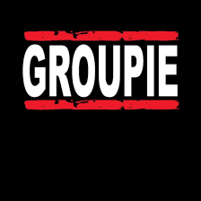

<div align="center" id="top">
  <h1>VISUALIZATIONS</h1>

  &#xa0;

</div>


<p align="center">


</p>

Status

<h4 align="center">
 🚧 🚀 Under construction...  🚧
</h4>

<hr>

<p align="center">
  <a href="#🎯objectives">🎯OBJECTIVES</a> &#xa0; | &#xa0;
  <a href="#🛠️features">🛠️FEATURES</a> &#xa0; | &#xa0;
  <a href="#🧭how_to_run">🧭HOW_TO_RUN</a> &#xa0; | &#xa0;
  <a href="#🖥️interface">🖥️INTERFACE</a> &#xa0; | &#xa0;
  <a href="#memo-license">License</a> &#xa0; | &#xa0;
  <h3 align="center">AUTEURS👤</h3>

<p align="center">
  <a href="https://learn.zone01dakar.sn/git/lodiouf" target="_blank">lodiouf</a> -
  <a href="https://learn.zone01dakar.sn/git/jgoudiab" target="_blank">jgoudiab</a> -
  <a href="https://learn.zone01dakar.sn/git/mawbdel" target="_blank">mawbdel</a>
</p>
</p>

<br>

## 🎯`OBJECTIVES:` ##
`Groupie tracker visualizations` consists of manipulating the data coming from the API and displaying it in the most presentable way possible to you. The Schneiderman's 8 Golden Rules of Interface Design must be followed:

    Strive for consistency
    Enable frequent users to use shortcuts
    Offer informative feedback
    Design dialogue to yield closure
    Offer simple error handling
    Permit easy reversal of actions
    Support internal locus of control
    Reduce short-term memory load

### 🛠️`FEATURES:` ##

- Rich visualizations: explore the details through well-organized maps of your favorite artists
-  User-friendly: An intuitive, interactive user interface makes navigation easy, providing a seamless experience for music fans.
- Real-time updates: Enjoy instant updates on artists, places and dates thanks to dynamic API integration.


## 🧭`HOW_TO_RUN`

### 🐾`TO RUN IT:`
_Make sure you're in the right folder, and set to terminal the command below to Start the web server:_
```bash
go run .
```

_Access the web application in your browser_
```bash
🌐 http://localhost:8080
```
### 📇`Summary of Steps` :

1️⃣ Users click on see artists to see a map of all the artists on the platform.

2️⃣ once in the artist interface.

    🔢 find your artist
    🔢 When the user clicks on the button "voir":
        artist information is displayed .
        click on the cross icon or just outside to close the artist info panel
    🔢 The user can repeat the process with new card or a different artist.

   <!-- - 🔢 -->

### 🚷`Error Handling`
The web server handles various error scenarios (errors that have been taken into account and should be avoided ), such as:
- ⚠️ 404 Not Found: Page not found.
- ⚠️ 400 Bad Request: Invalid request.
- ⚠️ 405 Method Not Allowed: HTTP request with an unauthorized method
- ⚠️ 500 Internal Server Error: Server-side errors.

## 🖥️`INTERFACE`

| Interface Principale | Interface Principale |
|:---------------------:|:---------------------:|
|  |  |


---


<a href="#top">Back to top ⬆️</a>
